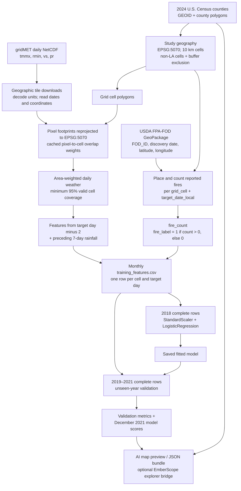
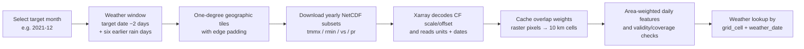
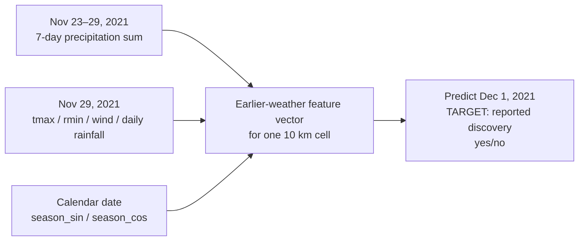
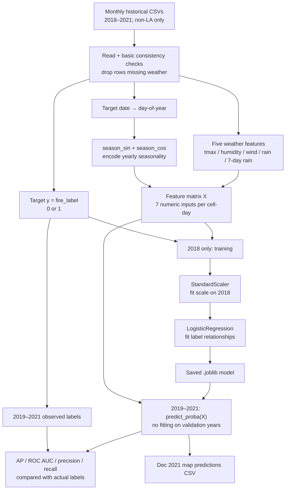
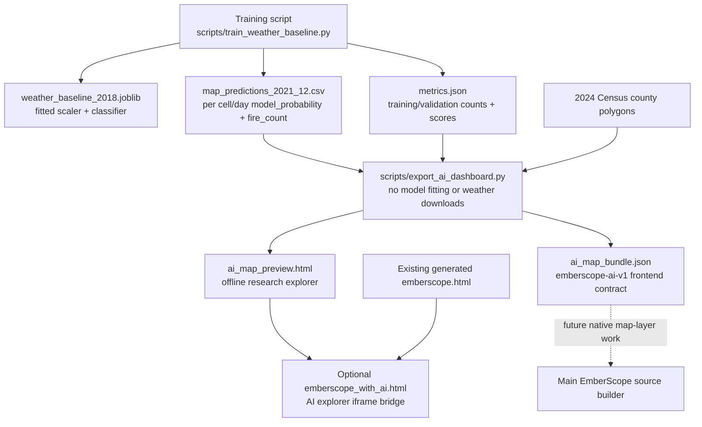
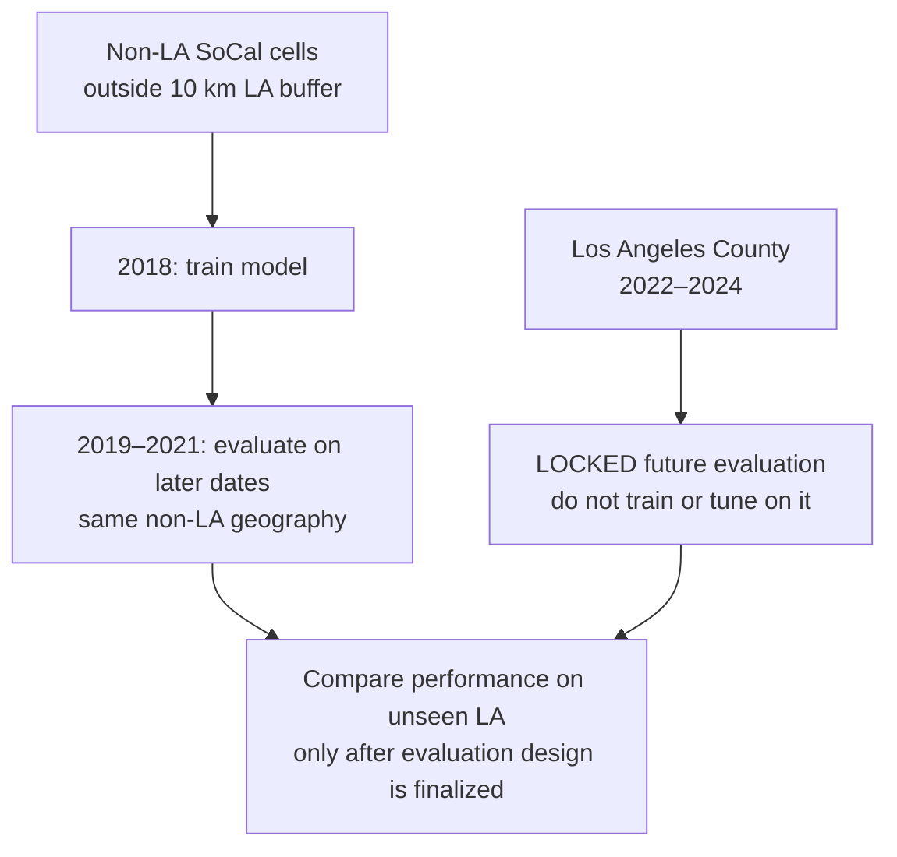
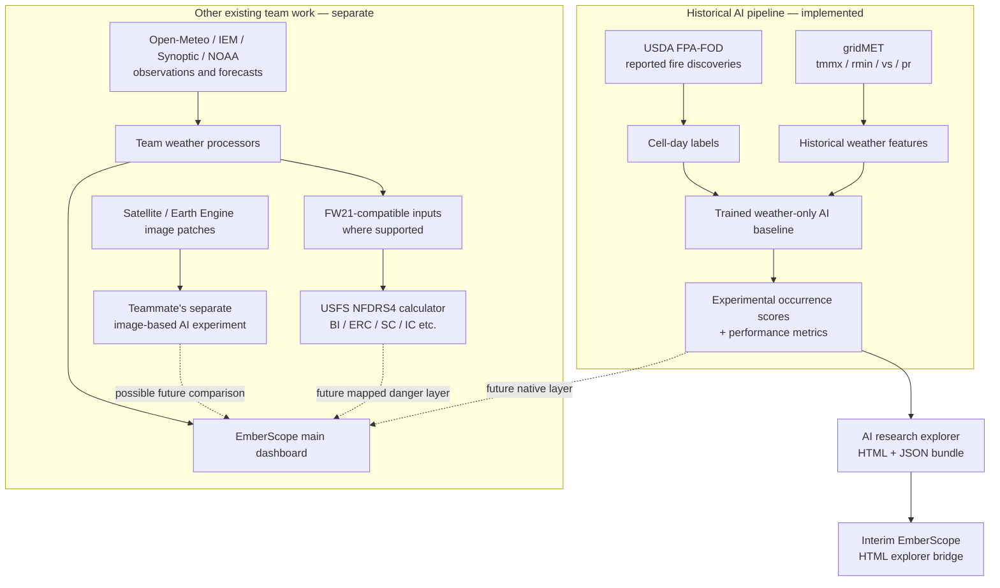

California Wildfire Prediction — Workflow and System Architecture
Purpose: Explain how the capstone's historical wildfire data, reconstructed weather, AI baseline, NFDRS4 work, and EmberScope interface relate to one another. This is both an onboarding guide and a technical reference. It describes the prototype as currently implemented; proposed integrations are identified explicitly.

Research status: A historical weather-based occurrence model has been trained and evaluated. It is not a live wildfire forecast, an official fire-danger rating, or a public warning system.

1. The project in one minute
Our larger capstone asks how weather, fire-danger calculations, historical wildfire records, and AI can help people understand wildfire conditions in California. The team already has weather collectors, an NFDRS4 workflow, and EmberScope mapping work. Our new historical AI workflow adds a dataset and an initial predictive model.

Think of the historical AI work as a classroom exercise:
1. Find out where and when a wildfire discovery was reported (the answer we want to learn to predict).
2. Look up weather from an earlier date at the same geographic location (the clues).
3. Repeat for many locations and dates, including dates with no reported discovery.
4. Train a model to recognize patterns in those clues; evaluate it on later years it has not seen.
5. Display its experimental occurrence scores alongside the observed wildfire discoveries on a map.
Important distinction: NFDRS4 estimates fire danger or potential fire behavior; our current AI estimates whether at least one reported wildfire discovery will be recorded in a cell on a target date. These are not interchangeable outputs.
Current component status
Component	Status	Role
Historical fire/label pipeline	Working	USDA fire discoveries → cell-day counts and labels
Regional gridMET weather pipeline	Working	Reconstructed daily weather → area-weighted grid features
Weather-based logistic-regression baseline	Trained and evaluated	Weather and season → retrospective occurrence score
AI preview and EmberScope HTML bridge	Working as a development integration	Historical scores, county boundaries, and metrics in a map; optional separate explorer panel
Team weather API collectors	Existing, separate	Observed conditions and forecasts for other team workflows
NFDRS4 calculation workflow	Existing, separate	Fire-danger indices; not currently AI features
Teammate's image/CNN experiment	Existing, separate experiment	An alternative image-based AI approach; not merged with this model
Native AI layer inside the main EmberScope source builder	Not implemented	A future direct integration, replacing the temporary HTML bridge
Los Angeles final holdout evaluation	Not performed	Reserved independent geographic/temporal assessment

2. End-to-end historical AI workflow
Read each arrow as “the output of this step becomes an input to the next.” The names in backticks are actual variables or file artifacts.

At a glance: The three original data inputs are (1) Census boundaries, (2) USDA wildfire records, and (3) gridMET weather. The main intermediate output is the monthly training_features.csv. The final research outputs are a fitted model, evaluation numbers, and map scores—not operational forecasts.
3. Input sources: exactly what comes in
Input	Where it comes from	Fields used	What it contributes
U.S. Census 2024 county boundaries	Local wildfire-datasets/boundaries/counties_2024.zip	GEOID, NAME, county polygon geometry, original CRS	Determines which places are in the study, and supplies map outlines
USDA FPA-FOD seventh edition	Local wildfire-datasets/FPA_FOD_20260615.gpkg, Fires table	FOD_ID, DISCOVERY_DATE, LATITUDE, LONGITUDE (with STATE and COUNTY retained for checking)	Historical reported wildfire discovery events; the outcome labels
gridMET daily weather	Provider's year-specific NetCDF datasets via a THREDDS grid-subset service	Four gridded variables: tmmx, rmin, vs, pr; day, lat, lon, and variable units/encoding	Historical reconstructed environmental conditions
Study configuration	config/ai/regions-v1.json	County IDs, evaluation county, grid CRS and size, buffer, source paths, split years	Keeps spatial and research rules consistent across runs

Weather input variables and units
Raw gridMET variable	Output column	Units	Interpretation
tmmx (daily maximum air temperature)	tmax_k	Kelvin (K)	Highest gridMET daily temperature; to convert to °C subtract 273.15
rmin (daily minimum relative humidity)	rh_min_pct	Percent (%)	Lowest daily humidity; small values indicate dry air
vs (daily mean wind speed)	wind_mean_ms	Meters/second (m/s)	Daily average wind speed; not gust speed or direction
pr (daily precipitation)	precip_mm	Millimeters (mm)	Rain/precipitation total on the chosen weather day
Derived from seven pr days	precip_previous_7d_mm	Millimeters (mm)	Sum of precipitation on the chosen weather day plus the six days before it

The original project also uses Open-Meteo, IEM, Synoptic, and NOAA forecast products in other workflows. Those sources are not secretly mixed into this particular AI training CSV. The current baseline uses gridMET exclusively for its historical weather features.
How a historical weather download is processed

The downloader handles requests that cross December/January by reading the appropriate year-specific weather files. Successful raw subsets and geographic weights are cached to reduce repeated downloads and calculations. Temporary server failures are retried.
4. Geography: how a place becomes a grid_cell
The study initially considers nine Southern California counties: Los Angeles, Ventura, Santa Barbara, Orange, Riverside, San Bernardino, San Diego, Imperial, and Kern.
1. Read the Census county polygons and convert them to EPSG:5070, a projected coordinate system measured in meters.
2. Lay down a consistent 10,000 m × 10,000 m grid. An identifier like -221_155 represents the cell's integer column/row indices, not a latitude/longitude pair.
3. Keep cells intersecting the eight non-LA study counties, but exclude cells intersecting Los Angeles or falling within the configured 10 km whole-cell buffer around the LA county polygon. This protects the final geographic evaluation from adjacent or overlapping training cells.
4. The resulting historical non-LA study population contains 1,349 eligible grid cells. Each appears once per target date, whether a fire was reported or not.
In the current implementation, the target for weather coverage is the whole 100 km² cell, not only the part inside a county. This matters for coastal and island cells. We identified 37 cells with inadequate weather coverage for every day in the investigated months; their weather fields remain blank, but their discovery labels are retained.
Why there is a separate spatial-weight cache
A 10 km cell overlaps several smaller gridMET weather pixels. Rather than taking only the weather pixel at the center, the code:
1. Infers each gridMET pixel's edges from its latitude/longitude coordinates.
2. Converts that pixel footprint from geographic coordinates (EPSG:4326) into the same projected CRS as our cells (EPSG:5070).
3. Calculates overlapping area between each weather pixel and each 10 km cell.
4. Stores those overlap weights in an .npz cache. Geometry is the same on subsequent dates, so it does not need to be recalculated daily.
5. Computes the area-weighted mean using only pixels with valid data. It reports valid area divided by total cell area as coverage_min_fraction (the minimum across the weather measurements used in that output row).
For a simple two-pixel example, if 25% of a cell is 300 K and 75% is 310 K, the area-weighted result is 0.25 × 300 + 0.75 × 310 = 307.5 K.

Coverage rule: If a weather variable has less than 95% valid area, its output is left missing rather than treated as zero. The full historical rows are still written, so the dataset doesn't silently lose places with incomplete coverage. Pixel edges are currently inferred, not independently validated against native grid-cell bounds.
5. Fire labels: how events become the target the AI learns
The wildfire pipeline reads the FPA-FOD Fires table for a selected target-date range, detects duplicate event IDs, and uses each event's coordinates to associate it with a county and 10 km cell. Events outside the eligible training region are not counted in its non-LA training rows.

For each (grid_cell, target_date_local) pair, it produces:
Output	Computation	Meaning
fire_count	Count of eligible unique reported discovery events in that cell on that date	Can be 0, 1, 2, ...
fire_label	1 when fire_count > 0, otherwise 0	The binary target for the first classifier

Example: Three discoveries reported in one cell on the same day produce fire_count = 3 but fire_label = 1. The current model predicts the yes/no label, not the exact number of fires or their severity.

What a zero really means: fire_label = 0 means no discovery was recorded in the FPA-FOD archive for that cell and date. It does not prove no ignition occurred. DISCOVERY_DATE is a reported discovery date and need not equal the fire's ignition time.
6. Why weather_date_gridmet is earlier than target_date_local
We want to ask “given earlier weather, was a wildfire discovery reported on a later date?” We must avoid giving the model measurements recorded after the supposed prediction.

For a row with target_date_local = 2021-12-01:
- weather_date_gridmet = 2021-11-29 because weather_lag_days = 2.
- tmax_k, rh_min_pct, wind_mean_ms, and precip_mm describe November 29 reconstructed conditions.
- precip_previous_7d_mm totals precipitation from November 23 through November 29, inclusive.
- fire_count and fire_label describe reported discoveries on December 1, not November 29.
We chose a conservative two-calendar-day lag because gridMET's daily reporting convention is not identical to a Los Angeles calendar day. This is not a proven optimal prediction lead time. Also, gridMET is a reconstructed historical product: an earlier date does not prove that exact value was publicly available when a real forecast would have been issued. Our current analysis is retrospective, not operational hindcasting with archived issued forecasts.
7. What the monthly CSV contains
The central file is data/ai/regional_weather_YYYY_MM/training_features.csv. One row = one 10 km cell × one target day.
CSV field	Type / units	Use
grid_cell	ID, e.g. -221_155	Geographic key; also connects rows to map cells
target_date_local	YYYY-MM-DD	Date of the outcome we are trying to predict
weather_date_gridmet	YYYY-MM-DD	Date of the weather used as a clue
tmax_k	K	Model input: maximum temperature
rh_min_pct	%	Model input: minimum humidity
wind_mean_ms	m/s	Model input: mean wind
precip_mm	mm	Model input: daily precipitation
precip_previous_7d_mm	mm	Model input: preceding seven-day precipitation total
fire_count	Nonnegative integer	Observed outcome: number of reported discoveries; not a model input
fire_label	0 or 1	Target y for model training/evaluation; not a model input
coverage_min_fraction	0 to 1	Quality field: lowest valid raster area fraction used by the row
weather_lag_days	Days, currently 2	Records the historical feature/target offset
spatial_method	Text	Records area_weighted_gridmet_pixels

For example, a real supplied row for cell -221_155 has target_date_local = 2021-12-01, weather_date_gridmet = 2021-11-29, tmax_k = 296.771, rh_min_pct = 27.178, wind_mean_ms = 4.064, and fire_label = 0. That represents a weather observation paired with a later no-reported-discovery label, not a model prediction.

Each monthly directory also includes a training_features.manifest.json recording source hashes, study configuration, dates, variables, aggregation settings, row/label counts, and references to raw subsets. The batch report summarizes monthly completion and quality. This supports reproducing the dataset without having to remember which commands generated it.
8. Model training and evaluation: what happens to those rows?
The AI is a weather-based statistical baseline, not a neural network. The implementation is in scripts/train_weather_baseline.py.

Actual model inputs
The classifier receives seven numerical features: the five weather columns listed above, plus two seasonal features derived from the target day of year:
- season_sin = sin(2π × day_of_year / 365.25)
- season_cos = cos(2π × day_of_year / 365.25)
The two seasonal columns describe time of year without falsely treating December and January as far apart. They are calculated at training/scoring time, not stored in the original monthly weather CSV.

A StandardScaler standardizes the feature values using statistics learned on 2018 training data. LogisticRegression then fits relationships between those standardized inputs and fire_label. When scoring, the same fitted scaler/model produces model_probability = predict_proba(X)[:, 1]—a number between 0 and 1 representing the model's experimental class-1 score.

What is deliberately not an AI input? fire_count, fire_label for the day being predicted, the target day's future weather, coverage_min_fraction, and the geographic cell ID. The cell ID is used to organize/map results, not as a predictor in this baseline.
Training, validation, and reported results
Stage	Period and area	Observations	Use
Training	2018, eligible non-LA cells	478,880 weather-complete rows, including 2,162 positives	Fit the scaler and logistic-regression coefficients
Validation	2019–2021, same eligible non-LA cells but later years	1,437,952 scored rows	Evaluate predictions against dates not used in fitting
Geographic/temporal holdout	LA County, intended 2022–2024	Not evaluated	Future independent geographic generalization study

Recorded validation metrics from the completed run:
Metric	Observed result	Plain-English meaning
Reported-fire prevalence	0.487%	Only about 5 in every 1,000 scored cell-days were positive
Average Precision (AP)	0.01086	Better ranking than random, but still low absolute precision
Random-ranking AP baseline	0.00487	Expected reference level given rare positive cases
ROC AUC	0.6639	Some separation between positive/negative observations; 0.5 is random ranking
Precision in top-scored 1%	1.87%	About 1.87% of top-ranked cell-days were positive
Recall in top-scored 1%	3.84%	The highest-ranked 1% found about 3.84% of positive cell-days

This establishes some retrospective ranking signal, not adequate public-warning performance. The output is not independently probability-calibrated. An apparent score of 0.003 may be displayed as 0.30%, but should not be presented as a trustworthy real-world ignition probability.
9. Model outputs and how EmberScope displays them

Artifact	What is inside it	What it is for
data/ai/weather_baseline_v1/weather_baseline_2018.joblib	Saved fitted preprocessing and classification model	Reuse the already-trained model (do not load untrusted model files)
data/ai/weather_baseline_v1/metrics.json	AP, ROC AUC, top-alert metrics, row counts, split settings	Honest model performance summary for the dashboard
data/ai/weather_baseline_v1/map_predictions_2021_12.csv	grid_cell, target_date_local, earlier weather, observed fire counts/labels, and model_probability	Retrospective daily scores for December 2021
data/ai/weather_baseline_v1/ai_map_bundle.json	emberscope-ai-v1 schema; cells, GeoJSON polygons, county boundaries, daily parallel probability/fire-count arrays, metrics	Stable handoff format for the frontend team
data/ai/weather_baseline_v1/ai_map_preview.html	Interactive offline Plotly research map, date selector, county outlines, metrics, explanatory text	Standalone informational AI visualization
emberscope_with_ai.html (optional)	New copy of the existing generated EmberScope HTML, with an AI explorer control/iframe	Interim combined demonstration; not a permanent native layer

How to interpret the map
- Colored squares: 10 km study cells, colored by higher/lower experimental occurrence scores on the chosen target date. These are not NFDRS4 fire-danger categories.
- Yellow discovery markers: Places where at least one FPA-FOD wildfire discovery was recorded on that target date. These are observed labels—not the AI's prediction.
- Gray squares: No computed score because the historical weather features were incomplete. Gray does not imply no fire danger.
- Census county outlines and names: Geographic reference. LA is shown as a boundary but has no score in this experiment.
- Date selector: Displays retrospective predictions for a chosen day in December 2021, based on weather two calendar days earlier. It does not display a live forecast.
- Hover: Lets a viewer inspect an individual cell's score and reported discovery count. Small score percentages require careful reading: 0.30% is not 30%.
The JSON contract stores probabilities as fractions (e.g. 0.003), with null for missing scores. A day's probability and fire-count arrays follow the same ordering as grid.cells. Cell geometry for mapping is exported as standard EPSG:4326 GeoJSON; the underlying analysis grid remains EPSG:5070.
10. Why Los Angeles County is excluded for now
Los Angeles is not being ignored because its data is unimportant. It is our main intended demonstration area, so we originally reserved it as an independent exam for the model.

Imagine a student practicing on one group of questions and then taking an exam with different questions. If they have already seen all the exam answers, the result tells us less about whether they actually learned a useful pattern. A similar issue arises in machine learning if training and evaluation use the same places and dates.

Our current experiment therefore makes two separations:
1. Geographic: Train and validate on eligible cells outside Los Angeles County. Exclude cells overlapping LA and a 10 km buffer to reduce near-boundary spatial overlap.
2. Time: Fit the model on 2018. Score it on 2019–2021, which were not used for fitting. A further LA 2022–2024 test is proposed but has not been run.

What question does this answer? Can relationships learned elsewhere in Southern California carry over to Los Angeles? It is a tougher, and scientifically interesting, test than simply checking the model on more of the same locations.

What it does not mean: We must forever forbid LA data from model development. A future operational LA model might be trained on older LA records and evaluated on later unseen LA data. That is a different experiment and would need a clearly defined new split.

Current caveat: We have previously flagged a possible discontinuity in reported LA wildfire records in 2022–2024. Before using those years as a definitive independent score, we must check whether reporting differences or missing labels make the comparison misleading. No LA result should be invented or shown on the map before that evaluation is performed.
11. Relationship to the team's other repositories and workflows
This is a combined-project architecture sketch, not a claim that every arrow has already been coded. Solid arrows below show an established role or data flow; dashed arrows are proposed integration points.

What each system would eventually provide to a unified map
System	Typical inputs	Operation	Output meaning	Current link to EmberScope
Weather collectors (team repo)	Live or historical API/station responses: temperature, humidity, wind, precipitation, forecasts, etc.	Retrieve, normalize, and visualize environmental data	Observed or forecast weather measurements	Existing in the team's own dashboard workflow; not the model's historical gridMET training source
NFDRS4 (USFS code + team pipeline)	Appropriate weather series, fuel model/configuration, site characteristics, initialization; FW21-compatible input where needed	Apply NFDRS4 fire-danger model	Fire-danger indices such as BI, ERC, SC, IC; not ignition probability	Separate workflow; native geographic link not completed
Weather-based AI baseline (this work)	Historical gridMET features + calendar season; FPA-FOD labels during training	Standardize features, fit logistic regression, then predict_proba	Experimental relative chance/ranking of reported wildfire discoveries by cell/day	AI preview + optional iframe bridge implemented; native layer pending
Teammate's image/CNN experiment	Earth Engine imagery and event-based image patches	Train image classifier in a separate workflow	Image-model classification outcome (not yet directly comparable to cell-day probability)	Not integrated into this AI dashboard
EmberScope (main team repo)	Weather layers, mapping data, generated research outputs	Display and explain layers	An interface, not itself the NFDRS4 or occurrence model	Existing main dashboard; temporary AI explorer integration available

Do not merge these outputs into one unlabeled “wildfire risk score.” Weather, NFDRS4 fire danger, observed thermal anomalies, historical wildfire reports, and AI occurrence estimates mean different things. Label each data layer with its source, time, units, and caveats.
12. Commands: reproduce the working stages
Run from the CS4961-01 repository root on Windows with the existing Python dependencies installed. These commands reuse the files already in the project; only run a stage if its output needs regeneration.
Goal	Command	Result
Build one regional month	python -m scripts.build_regional_weather --month 2018-07	regional_weather_2018_07/training_features.csv + manifest
Generate a historical range	python -m scripts.build_regional_weather --from-month 2019-01 --through-month 2021-12	Monthly CSVs + batch report; verified months skipped
Train and evaluate baseline	python -m scripts.train_weather_baseline	Saved model, metrics, December 2021 prediction CSV, initial model dashboard
Export AI info map + frontend bundle	python -m scripts.export_ai_dashboard	ai_map_preview.html and ai_map_bundle.json (no retraining)
Add optional AI panel to generated EmberScope	python -m scripts.export_ai_dashboard --embed-into emberscope.html	New emberscope_with_ai.html, original untouched
Run the repository tests	python -m unittest discover -s tests -p "test*.py"	Regression checks; does not establish scientific forecasting validity

To open the information-rich AI preview:
start "" "data\ai\weather_baseline_v1\ai_map_preview.html"
To open the interim combined demonstration, if previously generated:
start "" "emberscope_with_ai.html"
The export command does not train the model, fetch gridMET, or regenerate historical labels. It reads the already-saved map_predictions_2021_12.csv, metrics.json, and Census boundaries.
13. What has been learned—and what is still unverified
Confirmed by reported local runs: Monthly 2018–2021 non-LA regional extraction, area-weighted/cached weather calculation, dataset labeling, a fitted 2018 logistic-regression baseline, 2019–2021 validation, and the AI visualization/export workflow. Unit/regression tests also passed in earlier development stages.

Known limitations:
- Reporting is not ground truth of every ignition: FPA-FOD contains reported discovery events; no reported event is not guaranteed no fire.
- Retrospective weather is not as-issued forecast weather: The two-day lag reduces some leakage risk but does not establish exactly what forecasts were available historically.
- Incomplete coastal/island cells: The 95% whole-cell rule leaves some weather blank; those records cannot be scored without a defined missing-data policy.
- Pixel-footprint approximation: The EPSG:5070 overlap geometry uses inferred gridMET pixel edges and has been checked against an earlier implementation, not independently against native grid bounds.
- Model performance is modest and uncalibrated: AP and top-1% alert performance are not sufficient for public safety decisions. The baseline does not establish causal relationships.
- Current experimental scope: 2018 is training and 2019–2021 is validation. The broader 2010–2018 training proposal, statewide expansion, LA holdout assessment, NFDRS4 feature comparison, and native main-dashboard integration are not yet completed.
Recommended next project integration milestone
Build the AI layer natively inside the team's current EmberScope source dashboard, consuming the existing emberscope-ai-v1 JSON contract. Preserve source labels and dates, and retain the standalone AI explorer as a research reference. After that, evaluate an explicit NFDRS4-versus-weather-only model comparison as a separate scientific experiment.
Document updated to explain the complete workflow. The previous cleanup inventory and deletion guidance have been intentionally omitted. No production integration, repository cleanup, or new model evaluation is claimed by this document.